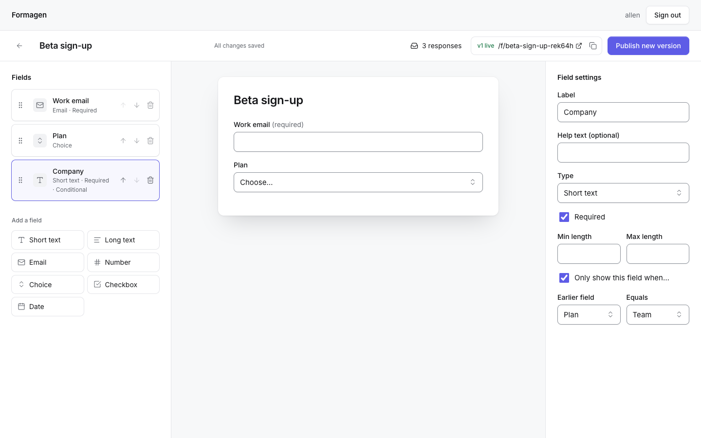
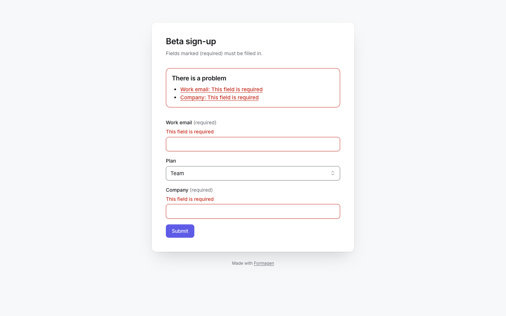
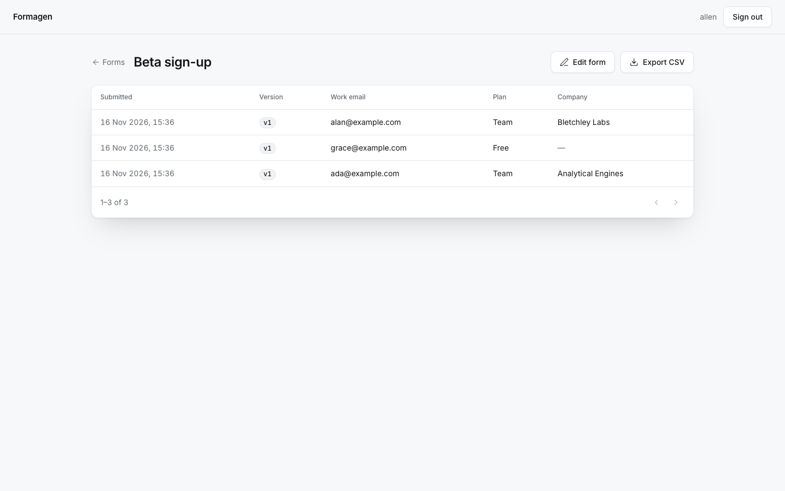

# Formagen

A server-driven form builder. Build a form, publish a version, share a public link, and see every response. Each form is a JSON schema, and every view of it is rendered from that schema: the builder preview, the public page, server-side validation and the CSV export.

**Live:** https://d1k95svn1jrdiu.cloudfront.net · [Architecture](docs/architecture.md) · [Measured results](docs/metrics.md)



## What it does

- **Builder** with 7 field types, validation rules and conditional logic ("show Company only when Plan is Team"). Fields reorder by drag and drop or keyboard. A live preview uses the same renderer as the public page, and drafts autosave.
- **Versioned publishing.** Each publish freezes the draft as an immutable v1, v2, …, and every response records the version it answered.
- **Public form page** that works with JavaScript turned off, meets WCAG 2.2 AA, and is served from the CloudFront edge.
- **Responses dashboard** with a version filter, pagination and one-click CSV export.

| Public form, with the error summary | Responses |
|---|---|
|  |  |

## Measured

From [`docs/metrics.md`](docs/metrics.md). Each row there records the commit it was measured on.

| | Result |
|---|---|
| Public form Lighthouse performance (mobile) | 99 → **100** after edge caching |
| Public form server response | 1,068 ms → **16 ms** |
| Public form JavaScript | 146 KB → **135 KB** |
| Axe WCAG 2.2 AA violations | **0** across 8 page states |
| Tests | **174** unit and integration, **7** end to end, all in CI |

CI enforces budgets on every push: Lighthouse performance ≥ 95, accessibility 100, CLS ≤ 0.01, JavaScript ≤ 150 KB.

## Stack

Next.js 16 (App Router, Server Components, Server Actions) · TypeScript · Zod · Zustand · TanStack Query · GraphQL (Yoga, Pothos, Codegen) · Drizzle ORM · Postgres on Neon · Auth.js · dnd-kit · Vitest · Playwright · axe · Lighthouse CI · AWS Lambda, CloudFront and S3 via SST

## How it fits together

```
 Admin (signed in)                         Public visitor
 Builder, forms list, responses            /f/[slug]: Server Component + Server Action
 Zustand + TanStack Query                  no GraphQL client, works without JS
        │ GraphQL                                  │ CloudFront edge cache
        ▼                                          ▼
 Yoga + Pothos (ownership checks)          rate limit → validate → save
        └──────────────┬───────────────────────────┘
               src/lib/forms (service layer)
               src/lib/schema (Zod: one schema, shared by every view)
                       ▼
               Drizzle → Neon Postgres
```

Key decisions, explained in [`docs/architecture.md`](docs/architecture.md):

- **GraphQL for the admin only.** The admin works with nested data (form → versions → responses). The public page needs one read and one write, so it calls the service layer directly and ships no GraphQL client.
- **One shared schema.** The client and server run the same Zod validator, so they can't disagree about what's valid.
- **Immutable versions.** Editing a form never breaks old responses.
- **No JavaScript required on the public page.** It's a real HTML form, and JavaScript adds inline validation and conditional fields on top.
- **Edge caching with invalidation on publish.** The public page reads no cookies, so CloudFront can cache it. A publish invalidates `/f/<slug>*`.

## Run locally

```bash
npm install
cp .env.example .env.local   # then fill in the values
npm run db:migrate
npm run dev
```

Checks: `npm run typecheck`, `npm run lint`, `npm test`. End-to-end tests (`npm run e2e`) need a local Postgres. See `E2E_DATABASE_URL` in [`playwright.config.ts`](playwright.config.ts).

## Deploy (AWS via SST)

Infrastructure is in [`sst.config.ts`](sst.config.ts). Region `ap-southeast-2`. Stages are `dev` and `production`, each with its own Neon database branch and GitHub OAuth app.

```bash
npx sst secret set DatabaseUrl  "<neon pooled url>" --stage production
npx sst secret set AuthSecret   "<random 32+ bytes>" --stage production
npx sst secret set GithubId     "<oauth app client id>" --stage production
npx sst secret set GithubSecret "<oauth app client secret>" --stage production
npx sst deploy --stage production
```

The GitHub OAuth app's callback is `<stage url>/api/auth/callback/github`. The deployed app uses Neon's **pooled** URL (Lambda scales out); migrations use the direct URL.

## How it was built

Built with Claude Code from a written [spec](docs/specs) and [plan](docs/plans), reviewed task by task. See [`CLAUDE.md`](CLAUDE.md) for how AI was used and where review changed the result.
